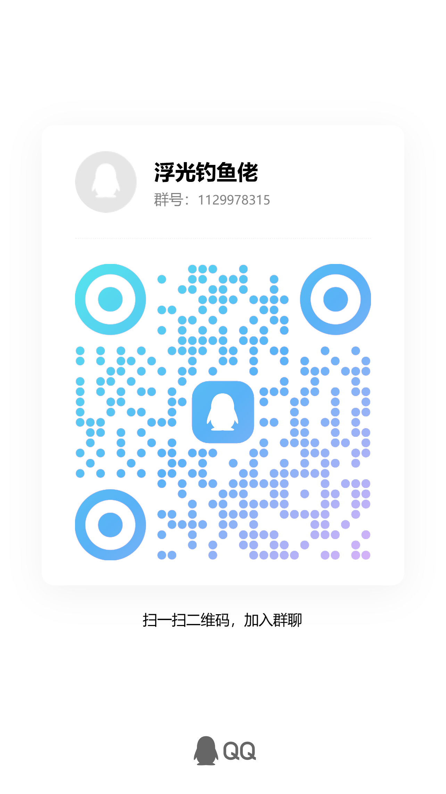

# 浮光 · 魔兽世界自动钓鱼助手
# Fuguang · WoW Auto Fishing Assistant

Windows 魔兽世界自动钓鱼工具：自动抛竿、鱼漂定位、咬钩声音检测与自动收鱼。用于学习交流与使用体验分享。

A Windows auto fishing assistant for World of Warcraft, with automatic casting, bobber locating, bite sound detection and automatic looting. Created for learning, discussion and sharing user experiences.

## 下载 / Download

打开本仓库右侧 **Releases**，下载最新版本中的 `Fuguang-WoW-Auto-Fishing-1.0.4.0-Windows-x64.zip`，完整解压后运行 `FishingLearned.exe`。

Open **Releases**, download the Windows x64 ZIP, extract the entire archive, and launch `FishingLearned.exe`. The interface is currently in Chinese.

GitHub 自动附带的 “Source code (zip)” 不是软件安装包，请下载上面命名的软件附件。

The automatically generated “Source code (zip)” archive is not the application. Download the named release asset instead.

## 功能 / Features

- 自动抛竿、等待咬钩和收鱼 / Automatic casting, bite monitoring and looting.
- 鱼漂校准与定位测试 / Bobber calibration and positioning test.
- 声音阈值调整 / Adjustable bite sound threshold.
- F10 快捷停止 / Stop at any time with F10.
- 运行记录与版本更新检查 / Activity log and update checks.

## 快速开始 / Quick start

1. 将游戏钓鱼技能放到快捷键 **1**，开启游戏声音。
2. 点击 **校准鱼漂**，在 5 秒内切回游戏；自动抛竿后按截图提示框选鱼漂，按 Enter 确认。
3. 点击 **测试定位**，按提示切回游戏，不要手动移动鼠标。
4. 测试成功后点击 **开始钓鱼**，在 4 秒内切回游戏。
5. 保持游戏在前台；需要停止时按 **F10**。

1. Bind the fishing skill to **1** and enable game audio.
2. Click **校准鱼漂** (Calibrate), switch to the game within 5 seconds, then select the bobber in the captured image and press Enter.
3. Click **测试定位** (Test positioning), switch back as instructed and leave the mouse untouched.
4. After a successful test, click **开始钓鱼** (Start) and return to the game within 4 seconds.
5. Keep the game in the foreground. Press **F10** to stop.

详细操作见 [用户使用手册](docs/用户说明.md)。

## 使用说明 / Availability

- Windows 64 位；本项目最初针对用户使用的“魔兽世界无限”客户端 1.60.1（70450）调整，其他版本兼容性需要实际测试。
- 需要联网，未激活用户可累计试用半小时；支持机器绑定的 30 天和终身授权。联系管理员了解激活方式。
- 本仓库用于软件介绍、下载与问题反馈，目前不提供应用源码；“学习分享”不代表全部功能免费或已开源。

- Windows x64. Initially tailored to the “魔兽世界无限” client version 1.60.1 (70450); compatibility with other versions is not guaranteed.
- An internet connection is required. Includes a cumulative 30-minute trial, with machine-bound 30-day and lifetime activation options. Contact the maintainer for activation details.
- This repository provides downloads, documentation and feedback. Application source code is not currently published.

## QQ 交流群 / QQ community

**群名称：浮光钓鱼佬**  
**QQ群号 / QQ group ID：1129978315**

可以在 QQ 中搜索群号，也可以扫描下方二维码。二维码失效时请使用群号。

Search for the group ID in QQ or scan the QR code below. Use the group ID if the QR code expires.

## 问题反馈 / Feedback

请通过 Issues 或 QQ 群提供：软件版本、游戏版本、操作步骤、错误提示和必要截图。不要公开激活码或硬件码。

Report issues through GitHub Issues or the QQ group, including app/game versions, reproduction steps and relevant screenshots. Do not post activation codes or hardware IDs publicly.

**作者 / Maintainer：Slayercjc**
